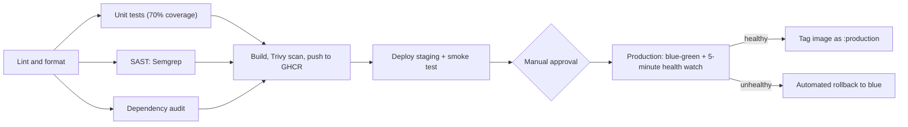

# CI/CD Pipeline with Security Gates

A production-style pipeline that takes a Node.js (Express) app from commit to Kubernetes, with five security and quality gates, a staging environment, a manual approval gate, and blue-green production deploys with automated rollback.

**Tools:** GitHub Actions, ESLint, Prettier, Jest, Semgrep, npm audit, Docker, Trivy, GitHub Container Registry (GHCR), kind (Kubernetes in Docker), bash.

## Pipeline diagram

- **Fan-out, then fan-in:** tests, SAST and the audit run in parallel after lint, and the build waits for all three.
- **Pull requests** run every gate and the build and scan, but never push an image or deploy.
- Pushes to `main` (and the manual **Run workflow** button) run the full pipeline.

## Stage map

Each of the brief's 11 stages, where it runs, and the evidence that it works.

| #   | Stage                     | Job                 | Tool               | Blocks the pipeline when                  | Evidence                                                                                                                                            |
| --- | ------------------------- | ------------------- | ------------------ | ----------------------------------------- | --------------------------------------------------------------------------------------------------------------------------------------------------- |
| 1   | Lint and format check     | `lint`              | ESLint, Prettier   | Any lint error or formatting difference   | [02](screenshots/02-pipeline-lint-test.png), [20](screenshots/20-lint-gate-blocked.png)                                                             |
| 2   | Unit tests with coverage  | `test`              | Jest, Supertest    | A test fails, or coverage falls below 70% | [01](screenshots/01-local-lint-format-tests.png), [21](screenshots/21-test-gate-blocked.png)                                                        |
| 3   | SAST                      | `sast`              | Semgrep            | Any high-severity finding                 | [03](screenshots/03-pipeline-sast-audit.png)                                                                                                        |
| 4   | Dependency audit          | `dependency-audit`  | npm audit          | Any high or critical vulnerability        | [04](screenshots/04-audit-gate-blocked.png)                                                                                                         |
| 5   | Multi-stage Docker build  | `build-scan-push`   | Docker             | The build fails                           | [05a](screenshots/05a-trivy-image-sha.png)                                                                                                          |
| 6   | Container image scan      | `build-scan-push`   | Trivy              | Any critical vulnerability                | [05b](screenshots/05b-trivy-summary.png)                                                                                                            |
| 7   | Push with SHA tag         | `build-scan-push`   | GHCR               | Skipped on pull requests                  | [06](screenshots/06-ghcr-package.png)                                                                                                               |
| 8   | Deploy to staging         | `deploy-staging`    | kind, `deploy.sh`  | Pods never become ready                   | [09](screenshots/09-staging-smoke-test.png)                                                                                                         |
| 9   | Smoke test staging        | `deploy-staging`    | `smoke-test.sh`    | Any of three checks fails                 | [09](screenshots/09-staging-smoke-test.png)                                                                                                         |
| 10  | Production approval gate  | `deploy-production` | GitHub environment | Not approved, or rejected                 | [10](screenshots/10-approval-gate-waiting.png), [15](screenshots/15-approval-gate-rejected.png)                                                     |
| 11  | Health check and rollback | `deploy-production` | `deploy.sh`        | A health check fails within 5 minutes     | [13](screenshots/13-production-blue-green-switch.png), [16](screenshots/16-rollback-drill-log.png), [17](screenshots/17-rollback-cluster-state.png) |
