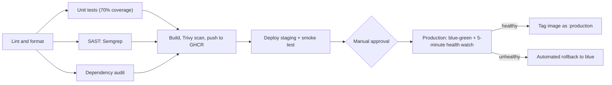

# CI/CD Pipeline with Security Gates

A production-style pipeline that takes a Node.js (Express) app from commit to Kubernetes, with five security and quality gates, a staging environment, a manual approval gate, and blue-green production deploys with automated rollback.

**Tools:** GitHub Actions, ESLint, Prettier, Jest, Semgrep, npm audit, Docker, Trivy, GitHub Container Registry (GHCR), kind (Kubernetes in Docker), bash.

## Pipeline diagram



- **Fan-out, then fan-in:** tests, SAST and the audit run in parallel after lint, and the build waits for all three.
- **Pull requests** run every gate and the build and scan, but never push an image or deploy.
- Pushes to `main` (and the manual **Run workflow** button) run the full pipeline.

## Stage map

Each of the brief's 11 stages, where it runs, and the evidence that it works.

| #   | Stage                     | Job                 | Tool               | Blocks the pipeline when                  | Evidence                                                                                                                                            |
| --- | ------------------------- | ------------------- | ------------------ | ----------------------------------------- | --------------------------------------------------------------------------------------------------------------------------------------------------- |
| 1   | Lint and format check     | `lint`              | ESLint, Prettier   | Any lint error or formatting difference   | [02](screenshots/02-pipeline-lint-test.png), [20](screenshots/20-lint-gate-blocked.png)                                                             |
| 2   | Unit tests with coverage  | `test`              | Jest, Supertest    | A test fails, or coverage falls below 70% | [01](screenshots/01-local-lint-format-tests.png), [21](screenshots/21-test-gate-blocked.png)                                                        |
| 3   | SAST                      | `sast`              | Semgrep            | Any high-severity finding                 | [03](screenshots/03-pipeline-sast-audit.png)                                                                                                        |
| 4   | Dependency audit          | `dependency-audit`  | npm audit          | Any high or critical vulnerability        | [04](screenshots/04-audit-gate-blocked.png)                                                                                                         |
| 5   | Multi-stage Docker build  | `build-scan-push`   | Docker             | The build fails                           | [05a](screenshots/05a-trivy-image-sha.png)                                                                                                          |
| 6   | Container image scan      | `build-scan-push`   | Trivy              | Any critical vulnerability                | [05b](screenshots/05b-trivy-summary.png)                                                                                                            |
| 7   | Push with SHA tag         | `build-scan-push`   | GHCR               | Skipped on pull requests                  | [06](screenshots/06-ghcr-package.png)                                                                                                               |
| 8   | Deploy to staging         | `deploy-staging`    | kind, `deploy.sh`  | Pods never become ready                   | [09](screenshots/09-staging-smoke-test.png)                                                                                                         |
| 9   | Smoke test staging        | `deploy-staging`    | `smoke-test.sh`    | Any of three checks fails                 | [09](screenshots/09-staging-smoke-test.png)                                                                                                         |
| 10  | Production approval gate  | `deploy-production` | GitHub environment | Not approved, or rejected                 | [10](screenshots/10-approval-gate-waiting.png), [15](screenshots/15-approval-gate-rejected.png)                                                     |
| 11  | Health check and rollback | `deploy-production` | `deploy.sh`        | A health check fails within 5 minutes     | [13](screenshots/13-production-blue-green-switch.png), [16](screenshots/16-rollback-drill-log.png), [17](screenshots/17-rollback-cluster-state.png) |

## Security gates

| Gate             | Tool             | Blocks on                                             | Why this threshold                                                                     |
| ---------------- | ---------------- | ----------------------------------------------------- | -------------------------------------------------------------------------------------- |
| Lint and format  | ESLint, Prettier | Any error                                             | Cheapest check, so it runs first (fail fast)                                           |
| Unit tests       | Jest             | Any failed test, or coverage below 70% on any measure | The brief's minimum, enforced in `package.json`, not just reported                     |
| SAST             | Semgrep          | High severity (`ERROR`)                               | Semgrep fails the build natively; CodeQL only reports, so it would be an advisory gate |
| Dependency audit | npm audit        | High or critical                                      | Audits devDependencies too, the stricter option                                        |
| Container scan   | Trivy            | Critical                                              | The brief's requirement; high findings are printed but do not block                    |

**Decisions worth explaining:**

- **The audit gate blocked a real problem.** Its first run failed on a high-severity flaw in `braces`, pulled in by `nodemon` ([04](screenshots/04-audit-gate-blocked.png)). `nodemon` was unused, so it was removed instead of weakening the gate. Production dependencies had 0 vulnerabilities throughout.
- **Coverage counts `app.js` only.** `server.js` only starts the server, which unit tests deliberately avoid. It is tested instead by the staging smoke test, against the real running app.
- **Scan before push.** The image is built and scanned on the runner, and only pushed if Trivy passes, so a vulnerable image is never published (shift left). The image pushed is the exact one scanned (build once, deploy many).
- **Proven to block.** Lint ([20](screenshots/20-lint-gate-blocked.png)), tests ([21](screenshots/21-test-gate-blocked.png)) and the audit ([04](screenshots/04-audit-gate-blocked.png)) were each shown failing and stopping later jobs.

## Deployment strategy

**Blue-green.** Each environment has two Deployments (`web-blue`, `web-green`) and one Service. `scripts/deploy.sh` reads which colour the Service points at, deploys the new image to the other colour, waits for its readiness probe, then switches the Service selector in one step. The old colour keeps running, so rollback is a single selector change.

**Zero downtime** comes from three things: readiness probes (no traffic reaches a pod before it is ready), a single selector switch, and the old colour staying up.

**Last known good version.** Each deploy job creates a fresh kind cluster, so production starts empty. After every successful production deploy, the image is tagged `:production` on GHCR. The next production run restores that tag as blue, then deploys the new SHA as green ([14](screenshots/14-production-cluster-state.png)). A rolled-back image is never tagged, so the rollback target is always verified.

**Health watch and automated rollback.** After the switch, `/health` is checked through the Service every 5 seconds for 5 minutes (30 seconds in staging). Any failure sends traffic back to the old colour and fails the job.

**Rollback drill.** The **Run workflow** button has a "Simulate a production failure" option. It removes the new colour's pods straight after the switch, proving the rollback works ([16](screenshots/16-rollback-drill-log.png), [17](screenshots/17-rollback-cluster-state.png), [19](screenshots/19-rollback-drill-run.png)).

**Notification.** Every production run writes its result (success or failure, image, commit) to the run's summary page ([11](screenshots/11-production-summary.png), [18](screenshots/18-rollback-summary.png)). Slack or Teams could be added with a webhook stored as a secret.

## Secrets and permissions

- **No stored secrets.** GHCR login uses `GITHUB_TOKEN`, which GitHub creates for each run and destroys afterwards.
- **Least privilege.** The workflow defaults to `contents: read`. Only the two jobs that push to GHCR get `packages: write`.
- **Pinned actions.** Every third-party action is pinned to a commit SHA, so a moved version tag cannot change what runs.
- **Production is locked down.** The `production` environment requires a named reviewer and only accepts deploys from `main`. Pull requests never push images or deploy.
- **Hardened pods.** Non-root (UID 1001), read-only filesystem, all Linux capabilities dropped, no privilege escalation, the default seccomp profile, no service account token, and CPU and memory limits.

## Setup guide

**You need:** a GitHub account, Git, and Node.js 24. Docker and kind are only needed to run the cluster locally; the pipeline creates its own.

1. **Fork or clone** this repo.
2. **Run the gates locally:**

```bash
   npm ci
   npm run lint && npm run format-check && npm test
```

3. **Set your image name.** In `.github/workflows/pipeline.yml`, change `thormie-harshey` in `IMAGE` and `PROD_TAG` to your GitHub username, in **lowercase** (GHCR rejects capitals).
4. **Create the environments** (repo **Settings**, then **Environments**):
   - `staging`: no rules.
   - `production`: tick **Required reviewers** and add yourself; under **Deployment branches and tags**, allow only `main`.
5. **Push to `main`.** The first run builds and pushes the image, deploys to staging, then waits for your approval.
6. **Make the image public, once.** After the first push, open your profile's **Packages** tab, then the package, then **Package settings**, then **Change visibility** to **Public**. kind pulls it without credentials.
7. **Approve** the production deploy from the run page (**Review deployments**).
8. **Optional rollback drill:** **Actions** tab, then **CI/CD Pipeline**, then **Run workflow**, tick **Simulate a production failure**, and approve. Production should roll back to blue and the run should fail.

**Repository layout:**

| Path                               | Purpose                                                                              |
| ---------------------------------- | ------------------------------------------------------------------------------------ |
| `app.js`, `server.js`              | The app (routes) and its start-up file                                               |
| `tests/`                           | Unit tests                                                                           |
| `Dockerfile`                       | Multi-stage, non-root image                                                          |
| `.github/workflows/pipeline.yml`   | The pipeline                                                                         |
| `.github/actions/setup-node-deps/` | Composite action shared by three jobs                                                |
| `k8s/`                             | Namespace, Deployment and Service templates, plus `staging.env` and `production.env` |
| `scripts/deploy.sh`                | Reusable blue-green deploy with health watch and rollback                            |
| `scripts/smoke-test.sh`            | Reusable smoke test                                                                  |
| `screenshots/`                     | Evidence                                                                             |

## Evidence

| #                                                                                    | Shows                                                                       |
| ------------------------------------------------------------------------------------ | --------------------------------------------------------------------------- |
| [01](screenshots/01-local-lint-format-tests.png)                                     | Lint, format and tests passing locally, 100% coverage                       |
| [02](screenshots/02-pipeline-lint-test.png)                                          | First pipeline run: lint and tests                                          |
| [03](screenshots/03-pipeline-sast-audit.png)                                         | Fan-out: tests, SAST and audit in parallel                                  |
| [04](screenshots/04-audit-gate-blocked.png)                                          | Audit gate blocking a real high-severity finding                            |
| [05a](screenshots/05a-trivy-image-sha.png), [05b](screenshots/05b-trivy-summary.png) | Trivy scanning the SHA-tagged image: 0 vulnerabilities                      |
| [06](screenshots/06-ghcr-package.png)                                                | Image on GHCR with its SHA tag                                              |
| [07](screenshots/07-k8s-template-test.png)                                           | One template set producing staging and production values                    |
| [08](screenshots/08-deploy-script-validation.png)                                    | Deploy script rejecting bad inputs                                          |
| [09](screenshots/09-staging-smoke-test.png)                                          | Staging deploy and three passing smoke tests                                |
| [10](screenshots/10-approval-gate-waiting.png)                                       | Pipeline paused at the production approval gate                             |
| [11](screenshots/11-production-summary.png)                                          | Production success notification                                             |
| [12](screenshots/12-full-pipeline-success.png)                                       | Full successful pipeline run                                                |
| [13](screenshots/13-production-blue-green-switch.png)                                | Production switching blue to green with a 300-second watch                  |
| [14](screenshots/14-production-cluster-state.png)                                    | Both colours running, Service on green                                      |
| [15](screenshots/15-approval-gate-rejected.png)                                      | A release rejected at the gate                                              |
| [16](screenshots/16-rollback-drill-log.png)                                          | Rollback drill: fault injected, health check fails, traffic returns to blue |
| [17](screenshots/17-rollback-cluster-state.png)                                      | After rollback: green at 0 pods, Service back on blue                       |
| [18](screenshots/18-rollback-summary.png)                                            | Failure notification after rollback                                         |
| [19](screenshots/19-rollback-drill-run.png)                                          | Drill run: all gates green, production failed safely                        |
| [20](screenshots/20-lint-gate-blocked.png)                                           | Pull request blocked by the lint gate                                       |
| [21](screenshots/21-test-gate-blocked.png)                                           | Pull request blocked by a failing test                                      |

## Known limitations and next steps

| Limitation                                                       | Why it was accepted                   | What a company would do                                                                        |
| ---------------------------------------------------------------- | ------------------------------------- | ---------------------------------------------------------------------------------------------- |
| Staging and production are namespaces in temporary kind clusters | Free, and needs no cloud account      | Separate, long-lived clusters (for example EKS or GKE), with OIDC login instead of stored keys |
| The author approves their own deploys                            | One-person project                    | Turn on **Prevent self-review** and require a second reviewer (four-eyes principle)            |
| Rejected runs show as failed in the run list                     | GitHub marks a rejected job as failed | The reason no status badge is shown here; teams usually read deployment history instead        |
| Templates use `envsubst`                                         | Light and easy to explain             | Kustomize overlays or a Helm chart as the project grows                                        |
| One failed health check triggers a rollback                      | Strict and simple                     | Tolerate brief blips, or use metrics-based analysis with Argo Rollouts or Flagger              |
| Pinned action SHAs do not update themselves                      | Security over convenience             | Dependabot opens pull requests to bump them                                                    |
| The image owner is written into the workflow                     | Keeps the file readable               | Build the name from the repository owner automatically                                         |
| Notification is the run summary only                             | No extra secrets needed               | A Slack or Teams webhook stored as an environment secret                                       |
| Bonus items not built: performance test, DORA metrics, OIDC      | Time, and no cloud provider in use    | k6 in staging; DORA from GitHub's deployment history; OIDC once a cloud cluster exists         |
